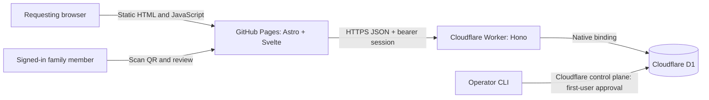
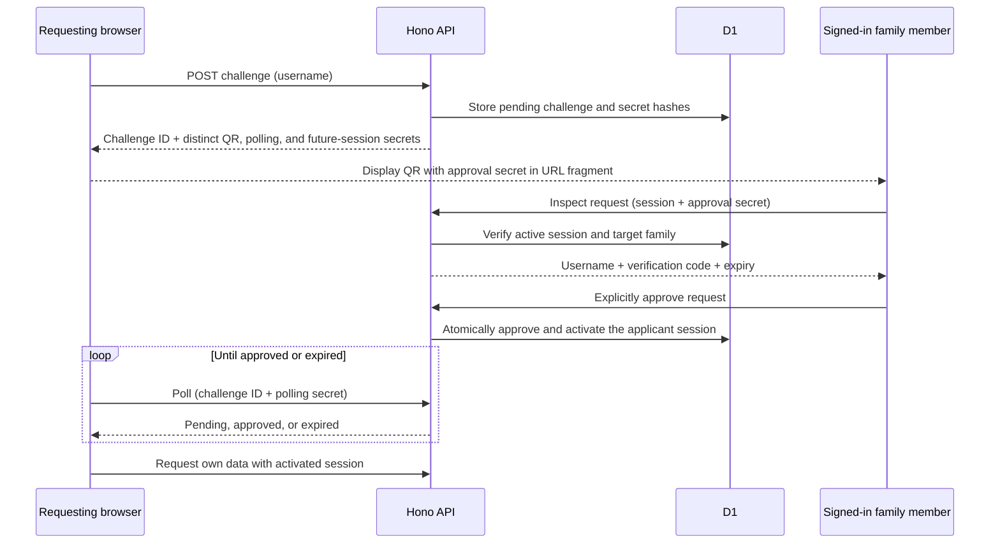

# Architecture and authentication

The monorepo separates three concerns: `apps/web` owns the static interface, `apps/api` owns authorization and persistence, and `packages/shared` owns event calculations and API types. The API is deployed independently from GitHub Pages. No server credentials or user records are included in the frontend bundle.

## Account and family model

Each user belongs to exactly one family. Family membership is assigned by the server; the member creation request contains a username, not a selectable family ID. An authenticated member can add another account to that member's family. There is no public registration route.

Families determine who can approve a login. Events remain individually owned and every event query is scoped to the authenticated user ID. Another family member cannot read or modify the target user's schedule by knowing its event ID.

The initial database has no users or sessions. Entering a username creates a pending login challenge, not an account. Only a control-plane operator action can create the first user and family while approving an existing pending challenge. Once that first account exists, bootstrap cannot create another first account.

## QR login protocol

The secrets have separate roles:

- The approval secret is carried only in the QR fragment, removed from the address bar before API calls, and sent to the API in a POST body. It cannot poll or authenticate a session.
- The polling secret belongs to the requesting browser and is never present in the QR code.
- The future-session token is issued to the requesting browser but remains unusable until approval. D1 stores its hash rather than the raw token. Poll retries observe the same result rather than minting another session.

The approver must already be authenticated and belong to the target account's family. Opening or inspecting a QR does not approve it; approval is an explicit POST. A user's existing session may approve that user's new device. This allows the first member to set up a second device without inventing another member.

A short verification code is shown on both devices so the approver can compare the request. The user should approve only a request they recognize. A forwarded QR represents the forwarded login request, so comparing the code and intended username matters.

## Browser sessions and cross-origin requests

GitHub Pages and the API use different origins. The frontend sends bearer tokens explicitly, which avoids depending on third-party cookies. Active tokens use API-specific local storage so a phone camera's new tab can find an existing session. Pending login details use session storage and expire with the challenge.

The API checks session existence, expiry, and revocation on protected operations. CORS permits configured frontend origins, not arbitrary websites. CORS is a browser boundary; it does not replace session and family authorization. Mutating endpoints require the expected request origin and JSON payloads.

GitHub project sites such as `aggre.github.io/progress/` share an origin with other `aggre.github.io` projects. Those projects therefore share the browser's origin trust boundary. A separate custom domain is the appropriate option if that origin contains untrusted applications.

## Public shell and private data

GitHub Pages cannot make a static bundle private through this application protocol. Visitors can download the login page and JavaScript. The interface waits for authenticated identity before mounting the schedule dashboard, and the API denies unauthenticated schedule and family requests. Build artifacts contain no user data, session credentials, or source archives.

## D1 and migration

The API uses the existing D1 database through its native Worker binding. The architecture migration preserves the previous event data without granting it to an arbitrary username. Legacy rows stay inaccessible until an operator deliberately claims them for the first account during bootstrap. There is no email-to-username fallback in API authorization.

Approval and bootstrap transitions must be atomic: a challenge activates at most one session, and concurrent bootstrap attempts create at most one first account. Login secrets are bounded and stored as hashes, pending requests expire, login creation and polling are rate limited, and logout revokes the active session server-side.

Countdowns continue to use the shared recurrence calculations. Their one-second UI updates do not generate API polling or database reads.

The schedule resource uses `/api/schedules`. The previous `/api/events` route remains a compatibility alias for older bundles. EasyPrivacy matches `workers.dev/api/event`, so using that route for application schedules can cause Brave to block legitimate requests.
